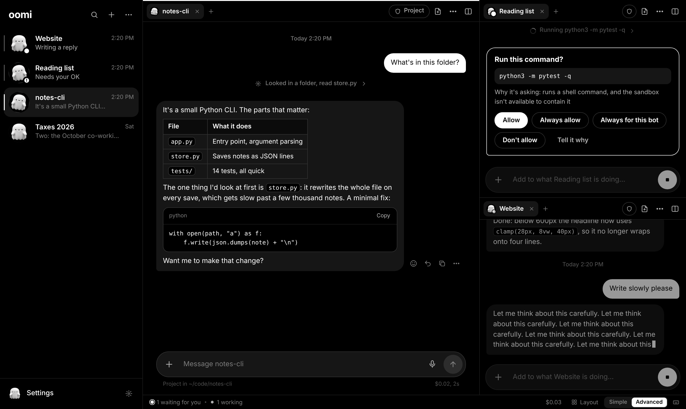

<p align="center"></p>

# oomi

A lean, self-improving agent for your Mac, built on Claude, whose team never fixes the same bug twice. It reads and edits your projects, runs commands in a sandbox, searches the web, learns what matters about you, and turns tasks you repeat into skills, while keeping every change visible and undoable.

It comes two ways, sharing one engine, one memory and one set of skills:

- **Oomi.app**, a black-and-white chat window. Each *bot* works in one folder and keeps one long conversation, and several can work at once: side by side in panes and tabs, or each in a window of its own.
- **The `oomi` command**, the same agent in your terminal.

<p align="center"></p>

## What it does differently

| | What oomi does |
|---|---|
| **Simple** | One core, two front ends. The config file holds 8 settings; everything else has a sensible default. |
| **Memory that works** | It learns automatically. Every few turns and when you quit, a cheap model reads what *you* said and adds, corrects or retires facts. New ones wait for review in Memory. Time-bound facts ("flight on 12 March") expire on their own, and contradicted ones are retired with a reason. Past conversations are searchable on demand instead of being stuffed into every prompt. Everything it believes about you is in one list you can edit. |
| **Recovers on its own** | If the main model is overloaded or unavailable it falls back automatically (Sonnet → Opus by default) and skips the failing model for two minutes. A rejected API key produces one clear message with a button to fix it. Background work (summaries, learning) runs on the cheapest model that answers, and never breaks the conversation. |
| **Small prompt** | About 2,400 tokens per request (system prompt plus 14 tool schemas), cached after the first call. Only the 10 best skills are listed; the rest are found by search and suggested when relevant. |
| **Skills that improve** | A skill is saved only after its check command passes **and** you approve it. Every use is scored. Notes from failures are shown next time, a skill that keeps failing is retired automatically, and when you ask for something you've asked for before, oomi offers to turn it into a skill. |
| **Understandable permissions** | Three trust levels per bot: Read-only (look, don't touch), Project (edit this folder; commands run in the macOS sandbox) and Full (no sandbox). Anything risky shows an approval card: Allow, Always allow, Always for this bot (that exact command, remembered and listed in bot settings), Don't allow, or tell it why. A block list holds commands no bot may run even with your OK, protected files (CLAUDE.md, .env, keys) always ask, secrets in command output are hidden from the model, and an unanswered card can decline itself after a time you set. Changes lists every file touched, including files a shell command changed, with diffs. Undo reverts one step at a time: edits, files a command created, or, after a risky command, the whole project from a snapshot taken just before it (an instant APFS clone). Undo never follows links out of the project, and it does nothing at all if a step can't be completed safely. |
| **Tells you how it's doing** | Status shows spending and tokens overall and for every bot, by day and by model, plus key health, model failures and fallbacks, sandbox state, memory and skills. |
| **Many bots at once** | The Advanced layout splits the window into panes, each with tabs. Drag a bot onto the middle of a pane to add a tab, onto an edge to split it; resize, minimize to a rail, zoom one pane, flip rows and columns, or pick a preset and save your own. Hold ⌘ to see pane numbers, ⌘1–9 to jump. Any bot can open in a window of its own, and the Overview (⌘.) shows every bot with what it's doing and lets you answer short approvals in place. |
| **Feels fast** | Replies stream as they're written, and each step shows as a line you can expand ("Ran 3 commands, edited app.py"). *Plan first* makes it look around without changing anything and propose steps; **Go ahead** or **Change the plan**. While it works you can keep typing: your message joins the task at its next step. Esc stops it. |

Safety from the first version is still all there. Web content and attachments "taint" the conversation: shell commands go offline unless you approve a networked one, and saving memories or skills asks first. Credentials (`~/.ssh`, Keychains, browser profiles) are unreadable from the shell. Dangerous commands always ask, and catastrophic ones (`rm -rf ~`, disk erase) are refused.

## Team antibodies on MongoDB Atlas

Your team never fixes the same bug twice. When a bot hits an error and fixes it, and the check that failed then passes, it turns what it did into an **antibody**: the error's fingerprint, the fix in one line, the steps, and proof that it worked. Once you approve it, the antibody lives in MongoDB Atlas, and every oomi on your team is protected. When any of them hits a matching error, even worded differently in a different codebase, Atlas finds the proven fix in one hybrid-search query. oomi tries that fix first and records how much time and money it saved.

Example terminal session:

```
› make the tests pass
▸ run_command python3 -m pytest
  exit 1
antibody ▸ this error matches a fix proven by Ivan (hybrid+rerank, 0.91): Python 3.10 removed the ABC
           aliases from collections; import them from collections.abc instead.
▸ edit_file shipping.py
▸ run_command python3 -m pytest
  exit 0
antibody ▸ cured in 9s, about 41s and $0.06 less than the first fix
```

### How an antibody is made

1. A command fails. oomi pulls out the lines that say what went wrong and strips everything that changes between machines: home folders, line numbers, addresses, timestamps (`oomi/fingerprint.py`).
2. It asks Atlas for a matching antibody (below). A match is attached to the failing command's result, so the model tries the proven fix first.
3. With no match, oomi remembers the failure and every edit and command after it.
4. When the same check passes again, that history becomes a candidate antibody. A small model writes the fix in a sentence or two.
5. **You approve it** before it's shared: in the app under Settings → Antibodies, in the terminal right after the fix (or later with `oomi antibodies review`). Pending and rejected antibodies are never matched, and secrets, emails and home folders are redacted before anything is saved.
6. Every time an antibody is offered, oomi records whether the check passed afterwards. Cures add up the time and money saved; an antibody that keeps failing is retired automatically.

### The MongoDB Atlas features it uses

| Feature | Where | Why it's needed |
|---|---|---|
| **Automated Embedding** | `antibodies_vector` index, `autoEmbed` on `error_text` with `voyage-4` | Atlas embeds stored errors and new ones itself: no embedding code, no vectors in documents |
| **Atlas Vector Search** | `$vectorSearch` with `query.text` | The same bug worded differently (`no attribute 'Mapping'` vs `'Iterable'`) |
| **Atlas Search** | `antibodies_text` index, `$search` | Exact words matter in errors: module names, error codes, commands |
| **Hybrid Search** | `$rankFusion` over both | Errors need both kinds of matching at once |
| **Voyage AI reranking** | native `$rerank` stage with `rerank-2.5` | Scores how well each candidate really fits, so oomi only offers fixes it's sure about |
| **Atlas Stream Processing** | `atlas/stream_processor.js` | Every error from every oomi, matched live into an `outbreaks` feed |

The whole match is one aggregation (`oomi/atlas.py`): `$rankFusion` (vector + text, filtered to your team and approved antibodies), then `$rerank`, then the top 3. If the cluster doesn't support a stage, oomi steps down to hybrid, then vector, then text search, and tells you why with `oomi match`.

### Set up Atlas

**1. Create the Atlas cluster.** Pick by what you need:

| Cluster | Hybrid + rerank + Automated Embedding | Stream Processing |
|---|---|---|
| **M10, MongoDB 9.0**, London region (recommended) | yes | yes |
| Flex | yes, if its version supports `$rankFusion` and `$rerank` | no |
| Free (M0) | Automated Embedding allows 3 queries a minute without a payment method | no |

In Atlas:
- **Database Access → Add New Database User**: password login, role *Read and write to any database*.
- **Network Access → Add IP Address**: your current IP (venue Wi-Fi can change it).
- **Project Settings → Native Reranking: $rerank in the Aggregation Pipeline**: turn it on (needs a Project Owner).
- **Connect → Drivers → Python**: copy the `mongodb+srv://…` string. Paste it into Settings → Account → Cloud sync in the app (it's kept in the Keychain), or put it in `MONGODB_URI` in `~/.oomi/.env`, one place for your keys that works in every project (`mkdir -p ~/.oomi && cp .env.example ~/.oomi/.env && chmod 600 ~/.oomi/.env`). A `.env` in the folder you run `oomi` from wins over it.

**2. Create the collections and search indexes** (or press *Set up search indexes* in Settings → Antibodies):

```bash
oomi setup-atlas
```

It waits until both search indexes can be queried. If your user can't create search indexes, create them in the Atlas UI (Search → Create Index → JSON editor) with `atlas/antibodies_text.json` and `atlas/antibodies_vector.json` on the `oomi.antibodies` collection.

**3. Set your team.** Everyone with the same `OOMI_TEAM` and cluster shares antibodies. Set `OOMI_USER` to your name.

**4. Stream Processing (M10+ only):**
- In Atlas, open **Stream Processing → Create Workspace** (SP2 is the smallest tier; it bills only while a processor runs).
- In the workspace's **Connection Registry → Add Connection → Atlas Database**, pick your cluster and name the connection `oomiCluster`.
- Connect mongosh to the workspace (its **Connect** button) with a user that has *Atlas admin*, then:

  ```bash
  mongosh "<workspace connection string>" --username <user> --file atlas/stream_processor.js
  ```

- Errors now appear in `oomi.outbreaks` as they happen, each with its closest antibody. Run `sp.outbreaks.stop()` when you're done.

Without a connection, oomi works exactly as before; Settings → Antibodies says how to connect.

### Demo

`demo/` has two small projects that break the same way on modern Python, one per teammate:

```bash
demo/reset.sh
# Terminal 1 (Ivan):  cd /tmp/oomi-demo/laptop-a-invoices && OOMI_USER=Ivan oomi
#   › make the tests pass        → oomi fixes it; approve the antibody
# Terminal 2 (Olga):  cd /tmp/oomi-demo/laptop-b-shipping && OOMI_USER=Olga oomi
#   › make the tests pass        → different code, different error text, cured by Ivan's antibody
oomi antibodies                  # cures and time saved
```

Run `oomi match "AttributeError: module 'collections' has no attribute 'Iterable'"` after the first fix to see the hybrid search and rerank scores, and adjust `OOMI_RERANK_THRESHOLD` if needed.

## Install

1. Download **Oomi-0.4.0-mac.zip** and double-click it. You get **Oomi.app** with the ghost icon. It runs on Apple Silicon and Intel Macs with macOS 11 or later and has its own Python built in, so there's nothing else to install.
2. Drag **Oomi** into **Applications**.
3. Open it. Oomi isn't from the App Store and isn't notarized by Apple, so macOS blocks the first launch:
   - **macOS 15 Sequoia or later:** click **Done**, open **System Settings → Privacy & Security**, scroll down to *"Oomi" was blocked…*, click **Open Anyway**, and confirm.
   - **macOS 14 or earlier:** right-click Oomi → **Open** → **Open**.

   That's a one-time step.
4. Paste your Anthropic API key ([platform.claude.com](https://platform.claude.com) → API keys). It's checked, then stored in your Keychain.
5. Make your first bot: give it a name, choose the folder it works in (or let it have its own folder in `~/Oomi`), and pick how much it may do.

## Using the app

- **Bots** are listed on the left with their latest message. A pulsing dot means it's working; **!** means it's waiting for your OK. **+** makes a new bot. Right-click a bot to pin it, put it in a section, duplicate, export or delete it; the **⋯** menu groups the list by section, status or folder and sorts it by recency, name, spending or your own order (drag to arrange). ⌘B hides the sidebar.
- **Simple or Advanced**, at the bottom right. Simple shows one conversation. Advanced turns the window into panes:
  - drag a bot from the sidebar (or a tab) onto a pane: the middle adds a tab, an edge makes a new pane;
  - ⌘\ splits right, ⌘⇧\ splits down, ⌘⌥ and an arrow moves between panes, ⌃Tab cycles tabs, ⌘W closes a tab;
  - ⌘⇧M minimizes a pane to a thin rail, ⌘⇧↩ zooms one pane, ⌘⇧F flips rows and columns, and the drag lines between panes resize them;
  - **Layout** offers presets (two side by side, a grid of four, one big and two small…) and saves your own arrangements. The layout comes back the next time you open oomi.
- **Own windows**: ⌘⇧O (or *Open in its own window* in a bot's menu) gives a bot a compact window you can keep on top. *New window* opens a second full oomi window.
- **Overview** (⌘.) shows every bot at once: what it's doing right now, what it's waiting for, and buttons to allow, stop or open it. **⌘K** finds a bot, a message or a command. **⌘/** lists every shortcut.
- **Messages**: Enter sends, Shift-Enter starts a new line. **+** attaches images, PDFs and text files (or drop them on a conversation, or paste a screenshot), and turns on *Plan first*. The microphone starts macOS Dictation. Hover a message to react, reply to it, copy it, or tell oomi to remember it.
- **While it works** the send button becomes Stop (Esc does the same). Anything you send meanwhile is added to the task.
- **A bot's header** shows its trust level (click to change it), *Offline* when outside content has turned networked commands off (click to turn the network back on), **Changes** with a count, and a menu. **Bot settings** has its name, folder, trust, model, effort and spending limit, standing **instructions** it always follows, the commands it may always run, how full its conversation is (with *Compact now*) and its spending.
- **Settings** (⌘,) has General (key, models and fallbacks, spending, web search, keep the Mac awake, export/import/reset), Display (layout, tool steps, text size, density, width, timestamps, cost under each reply), Notifications (which events, and a sound), Safety and limits (block list, protected files, hidden secrets, approval timeout, CLAUDE.md and AGENTS.md, time and step limits), Memory, Skills, Status (spending and tokens overall, per day, per model and per bot) and Shortcuts. The search box finds any setting.
- **Start fresh** begins a new conversation for a bot without losing the folder, instructions or what it learned about you. Deleting a bot removes its chat history, never its folder.
- When a bot finishes, needs you or hits a problem while you're looking elsewhere, you get a notification (you choose which) and the Dock icon shows a badge.

Closing the window (or ⌘Q) stops any running work, lets each bot learn from the conversation, and saves. Logs are in `~/.oomi/logs/app.log`.

## Using the terminal

```bash
cd ~/code/my-project
oomi                          # interactive
oomi -p "why is the test suite failing?"     # one request, then exit
oomi -c                       # continue the last session in this folder
oomi --trust read-only        # just look
oomi gui                      # open the window (from a source install)
```

The app's copy works from any terminal once linked onto your PATH: `ln -s /Applications/Oomi.app/Contents/Resources/bin/oomi /usr/local/bin/oomi`.

| In a session | |
|---|---|
| `/status` | health card |
| `/changes` · `/changes diff [file]` | what it changed this session |
| `/undo` · `/undo all` | take changes back |
| `/trust read-only\|project\|full` | change the trust level |
| `/plan` · `/go [tweaks]` | propose first, then approve |
| `/memory` · `/memory review` · `/memory edit` | see, review and edit what it remembers |
| `/remember …` · `/forget 12` | teach or correct it directly |
| `/skills` | saved skills and their track record |
| `/model claude-opus-5-5` · `/effort high` | more power for hard problems |
| `/budget 5` · `/compact` · `/reset` · `/exit` | |

When oomi asks for approval, answer `y`, `a` (allow this exact command for the rest of the session; never offered for dangerous ones), `n`, or type a note. A note declines and tells oomi why. Ctrl-C stops a running task and lets you type a note to steer it.

Outside a session: `oomi memory review|edit|history`, `oomi skills`, `oomi stats`, `oomi doctor`, `oomi eval memory`.

Team antibodies: `oomi antibodies` (your team's proven fixes, cures and time saved), `oomi antibodies review` (approve ones saved for later), `oomi match "<error text>"` (what an error would match, and how sure Atlas is), `oomi setup-atlas` (collections and search indexes). After a request that fixed an error, oomi shows the fix and asks whether to share it.

**From source** (for development): `./install.sh` installs the `oomi` command with uv (with the window on a Mac).

## Trust levels in detail

| | read files | edit project | shell commands | write outside project |
|---|---|---|---|---|
| `read-only` | ✓ | ✗ | read-only ones (`ls`, `rg`, `git diff` …) | ✗ |
| `project` (default) | ✓ | ✓ | ✓ inside the sandbox | asks |
| `full` | ✓ | ✓ | ✓ no sandbox | ✓ |

These hold at every level:
- Dangerous commands ask: `rm -rf`, `sudo`, `osascript`, `security`, `launchctl`, `defaults write`, force-push, and so on.
- Protected paths ask.
- Catastrophic commands are refused.
- Writes into `.git/` ask, because hooks and config there can run code.

Once untrusted content is in the conversation, networked commands ask. In `full`, so does every non-read-only command, because there's no sandbox to keep it offline.

The sandbox is Apple's Seatbelt (`sandbox-exec`, the same mechanism Claude Code and Codex use). Commands can write only in the project, temp folders and tool caches. `.git/hooks` is read-only. Apple has deprecated and never documented it, though it still ships with macOS. Command detection is pattern-based, so in `project` mode the sandbox, not the pattern list, is the real boundary. For genuinely hostile code, use a VM.

## Memory in detail

- **Where it lives:** `~/.oomi/memory.db` (SQLite).
- **Small store:** while it's under 6,000 characters, every fact is shown once per session, so recall is complete.
- **Larger store:** each turn retrieves the relevant facts with keyword search plus a cheap Haiku call that adds synonyms. Preferences are always included.
- **What the learner sees:** only your own messages. oomi's replies, tool output and web pages never reach it, so nothing oomi reads or repeats can plant a memory. Secrets (keys, passwords, tokens, card numbers, private keys) are refused at write time.
- **Confirmation:** newly learned facts are used straight away, but labelled as unconfirmed and never treated as preferences until you keep them (`/memory review`). A fact you've confirmed is never rewritten in place: it's retired, kept in history (`oomi memory history`), and the new version goes up for review.
- **Measuring it:** `oomi eval memory` tests a labelled set. With keyword search alone, recall@5 is 100% when the question shares a word with the fact, but only 13% for pure paraphrases. Query expansion is meant to close that gap; run the eval with your key set to see by how much. A Voyage key (optional, in `oomi setup`) adds embedding search, which the eval also measures.

## Configuration

`~/.oomi/config.json` holds just these:

```json
{
  "model": "claude-sonnet-5-5",
  "trust": "project",
  "effort": "medium",
  "max_session_cost_usd": 2.0,
  "fallback_models": ["claude-opus-5-5"],
  "web_search": true,
  "notify": true,
  "sandbox_extra_writable": ["~/Library/Caches", "~/.cache", "~/.npm", "~/.cargo/registry"]
}
```

### From Hermes

Ideas borrowed from [Hermes Agent](https://github.com/NousResearch/hermes-agent):

- **Project notes.** At the start of a session oomi reads `.oomi.md`, `CLAUDE.md` and `AGENTS.md` from the bot's folder up to the git root and follows them (12,000 characters at most). A file that looks like a prompt injection is shown to the model as untrusted data. Writing any of them asks first. Turn it off with *CLAUDE.md and AGENTS.md* in Settings → Safety and limits.
- **Scheduled tasks.** In Bot settings, give a bot a prompt and a time ("weekdays at 18:30", "mondays at 9", "every 2 hours", or a cron line) and it runs in that bot's conversation while oomi is open. Nobody is there to approve, so anything that would ask is declined. A run missed while oomi was closed happens once on launch if it's under 12 hours late. Three failures in a row turn a schedule off. They live in `~/.oomi/schedules.json`.
- **Quick commands.** `"quick_commands": {"test": "pytest -q"}` makes `/test` run that in the bot's folder without calling the model, with the same trust and approval rules as any command.
- **Longer prompt cache.** `"cache_ttl": "1h"` keeps the cached prompt for an hour instead of five minutes. Writing it costs twice the input rate; reading it stays cheap.
- **Memory and skills per bot.** Every bot has its own memories and skills next to the ones all bots share, and its settings show what it has spent and learned. Share a memory or a skill to give it to every bot.

### Connected apps

Settings → Apps connects bots to other apps through their hosted MCP servers: Notion, Linear, Atlassian, Intercom, GitHub, Sentry, Vercel, Supabase, Cloudflare, Neon, Hugging Face, Figma, Canva, Stripe, PayPal, PostHog, Context7, DeepWiki and Exa, plus any MCP server you add by address. Signing in opens your browser; tokens are kept in the Keychain. Tools an app marks read-only just run; anything that changes something there asks first (*Always allow* works per tool), and what an app sends back is treated as untrusted, like a web page. Each bot's settings can switch apps off for that bot.

Settings you change in the app (block list, protected files, limits, notifications…) are added to the same file. Others in `oomi/config.py` can be added by hand if you ever need them. Window layout and display choices are kept in `~/.oomi/ui.json`. Prices are from Anthropic's pricing page as of October 2026: Sonnet 5.5 costs $2 input / $10 output per million tokens, Haiku 5.5 $0.10 / $0.50, and web search $10 per 1,000 searches.

## Development

```bash
uv venv && uv pip install -e '.[dev]'
.venv/bin/pytest -q
python3 tools/make_icon.py assets/oomi-ghost-source.png   # regenerate the icon
python3 tools/make_ghosts.py                              # regenerate oomi's colors from assets/oomi-ghost-colors.png
```

349 tests drive the real agent loop with a scripted model (no API key needed), including the Anthropic SDK request and stream path over a mocked transport, stopping and interjecting from another thread, and the app's local server end to end (approvals, uploads, undo, settings, memory, the workspace endpoints, antibodies with mongomock), plus the Markdown renderer against injection and slow input and the pane layout model against thousands of random edits. What they can't cover from a Linux build machine is macOS itself: Seatbelt, APFS clones, the Keychain and the native window. `oomi doctor` checks the first three on your Mac.

### How the app is put together

- `oomi/gui/server.py` serves the window on 127.0.0.1 with a random per-launch token; requests from other hosts or without the token are refused, and the page runs under a strict Content-Security-Policy. Live updates arrive over Server-Sent Events.
- `oomi/gui/runtime.py` gives each bot its own thread and oomi agent. Approval cards block that thread until you answer.
- `oomi/gui/static/` is the interface: plain HTML, CSS and JavaScript, no framework or build step. `layout.js` is the pane layout as data, `chat.js` one conversation, `panels.js` settings, drawers, the overview and the palette, and `app.js` the workspace that ties them together. Model output is rendered by a small Markdown renderer that escapes everything first, so a reply can't inject HTML.
- `macapp/launcher.c` is the app's executable. It loads the bundled Python and runs the window, so macOS shows Oomi (not Python) in the menu bar and Dock.

### Building Oomi.app

```bash
pip install ziglang          # compiles the executable for both chips, from any OS
# rcodesign: github.com/indygreg/apple-platform-rs/releases (seals the app with an ad hoc signature)
python3 tools/build_app.py --arm64 cpython-3.13.*-aarch64-apple-darwin-install_only_stripped.tar.gz \
                           --x86_64 cpython-3.13.*-x86_64-apple-darwin-install_only_stripped.tar.gz
```

The Python builds come from [python-build-standalone](https://github.com/astral-sh/python-build-standalone). `--linux <tarball>` builds the same layout around a Linux Python to test the packaging without a Mac.
